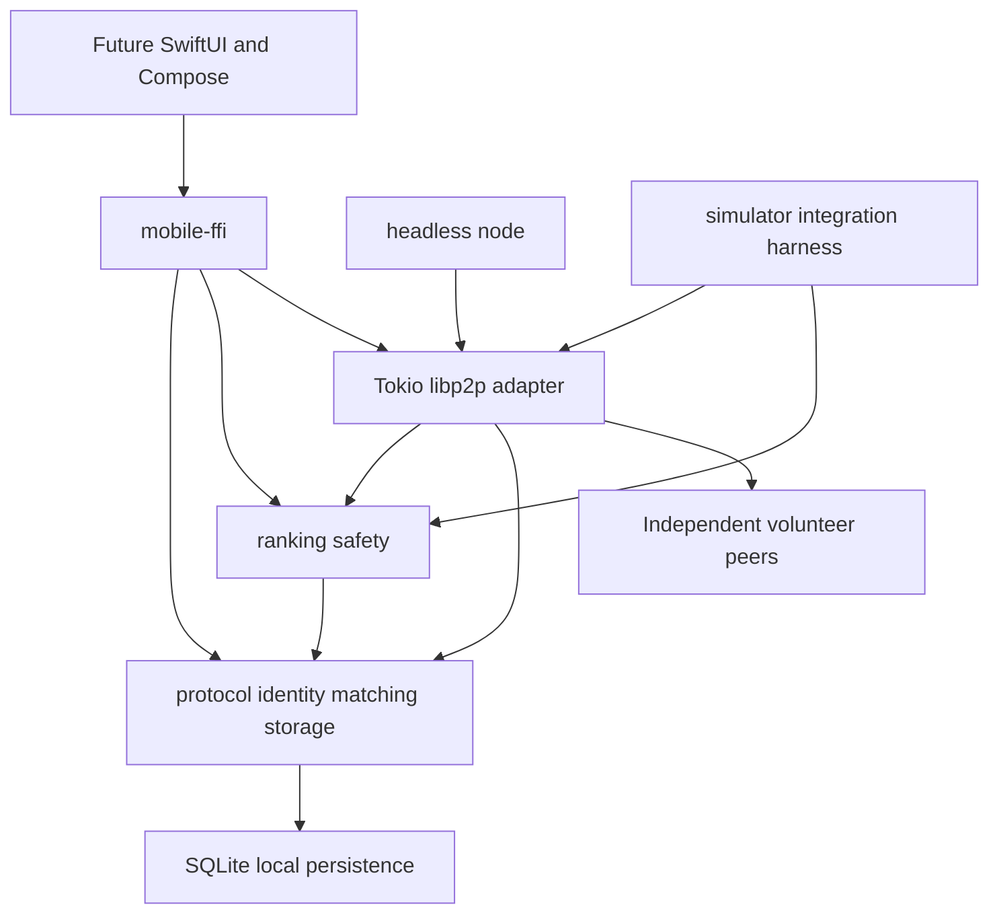

# Architecture

Normative layers: protocol and domain core → network adapters and local intelligence → mobile facade, headless volunteer executable, simulator. Dependencies flow inward. No libp2p types cross the mobile boundary. The implementation may group related modules into a small number of crates; [contracts](contracts.md) fixes module ownership before implementation.

Accounts own application signing and recipient encryption keys. Node transport identities are separate. Issuers authenticate CIE attributes and sign minimized key-bound attestations. Storage peers retain signed public records and opaque private envelopes under finite leases. Client domain services verify all trust-bearing data, regardless of transport authentication.

The principal agent owns this KB and architecture. Delegated Rust agents own code and repository scaffolding only after contracts exist. No implementation may quietly redefine signed bytes, credential validity, matching transitions, or replica ownership. New tradeoffs require an [ADR](decisions/README.md).

## M2 lifecycle

Reuse the four crates. Core gains a portable encrypted AccountKeyStore and additive transactional notification/checkpoint tables. Network gains separate stable NodeIdentityStore and a finite metered sync service. Mobile facade owns authorized account/session handles and cancellation. A native scheduler grants execution time but is not part of the matching protocol. [M2 contracts/UML](uml/m2.md) define ownership and restart behavior. No permanent daemon or centralized push component is introduced.

## M3 application service

AnnodaClient in annoda-network composes core, intelligence and finite transport; network now depends on intelligence. [Application API](application-api.md) defines ownership, and [ADR 0006](decisions/0006-application-service.md) records rationale. No native client coordinates private keys, SQL or raw envelopes.
