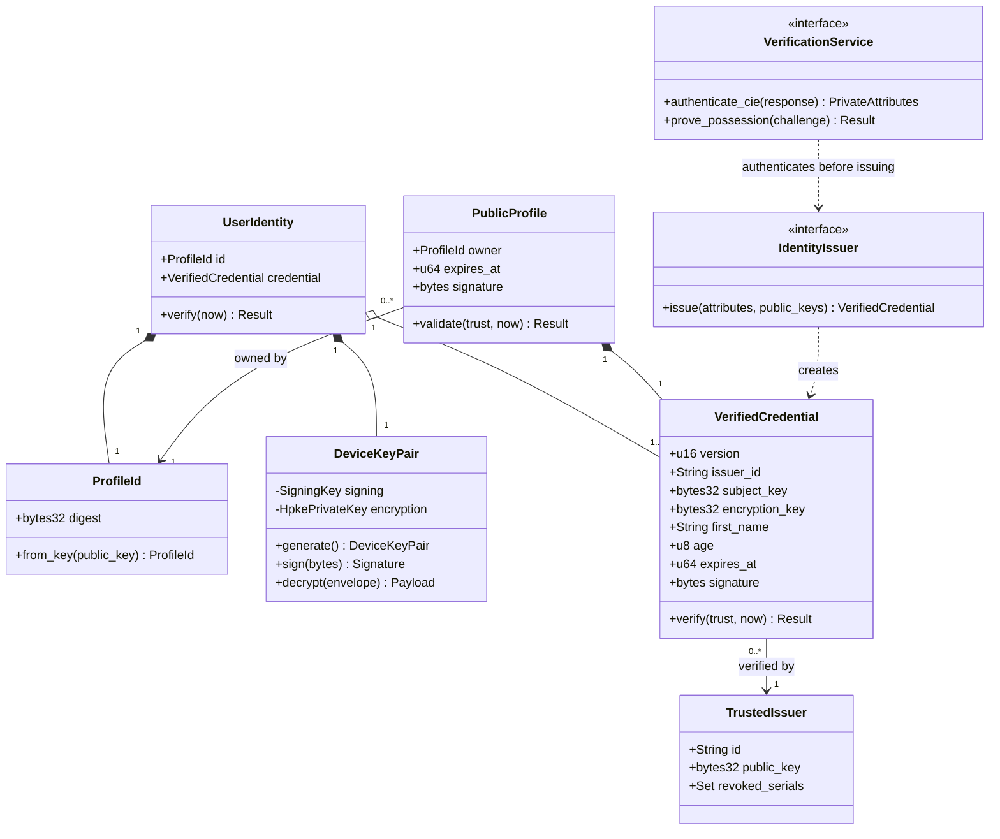
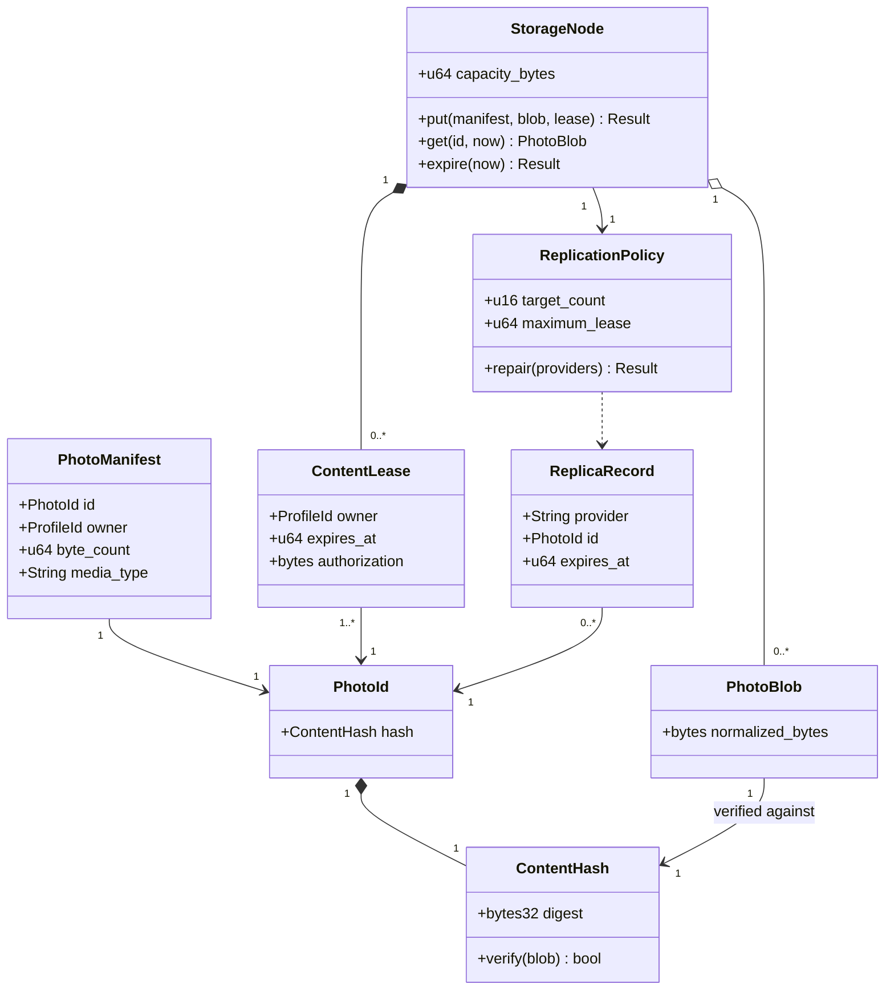
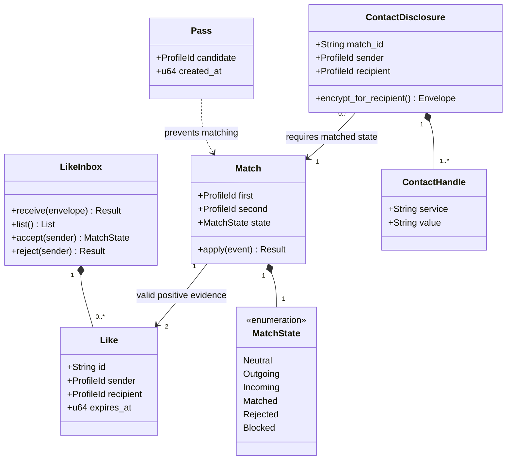
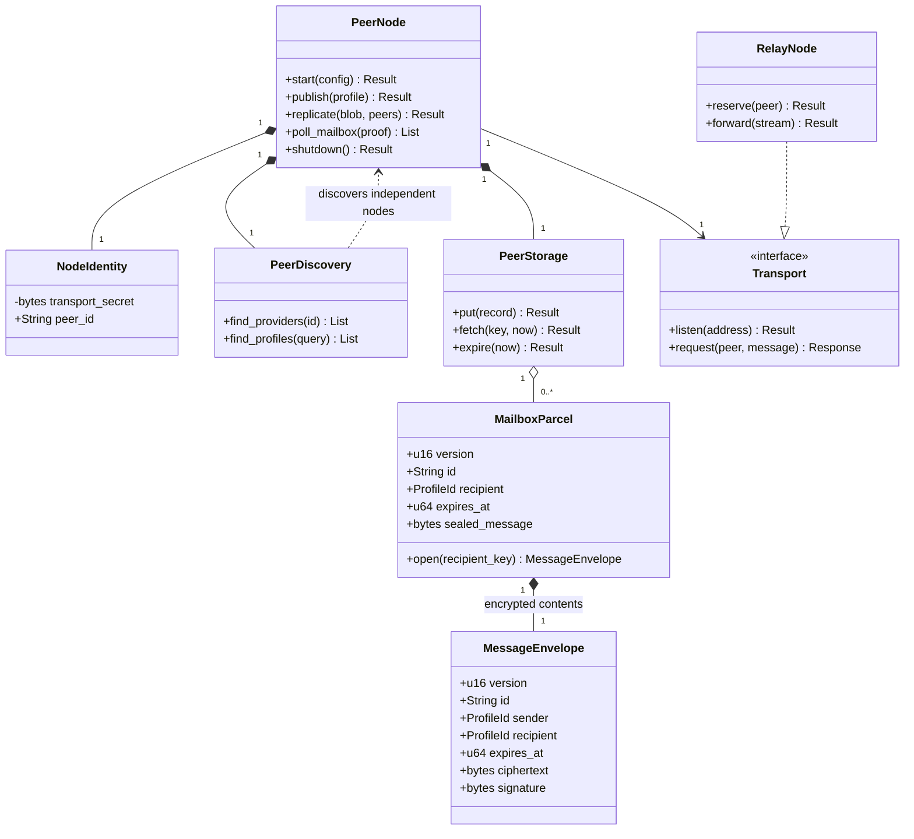
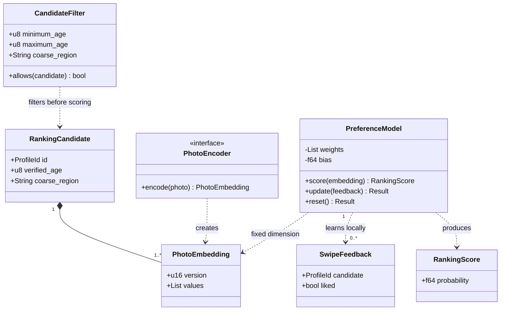

# Domain class models

All diagrams are normative logical models. Names map to structs/enums/traits in modules listed below; actual delivered paths are tracked in [progress](../progress.md). Multiplicities describe domain ownership, not Rust allocation layout.

## A. Identity and account

Mapping: core::identity structs DeviceKeyPair, VerifiedCredential, TrustedIssuer; core::protocol ProfileId/PublicProfile; IdentityIssuer trait. UserIdentity is account aggregate; VerificationService is planned CIE adapter trait/module. Invariants: credential subject matches owner and signing proof; issuer binds both keys; public age/name derived from attestation; private identity attributes never enter DHT. [Identity authority](../identity.md).

## B. Photographs and distributed storage

Mapping: core::storage content/hash, manifest/blob/lease structs and SQLite PeerStorage; network::replication implements StorageNode/ReplicationPolicy behavior; provider metadata maps ReplicaRecord. Logical wrapper names may be type aliases. Invariants: hash verifies bytes; independent owners have distinct leases; expiry prevents reads immediately; replication success requires distinct acknowledgements. [Storage authority](../storage.md).

## C. Matching

Mapping: core::matching structs/enums and SQLite inbox/state service. LikeInbox and Match may be service/record combinations; MatchState is enum; Pass can map private state transition. Invariants: sender authenticated, recipient alone decrypts, duplicates do not reapply, rejection/blocking cannot be bypassed by delay, contacts gated separately. [State table](../matching.md).

## D. Network

Mapping: network PeerNode actor, libp2p identity NodeIdentity, Kademlia PeerDiscovery, request/response Transport; core protocol MessageEnvelope, SQLite PeerStorage. RelayNode is planned libp2p circuit-relay adapter, not storage forwarding. Invariants: account identity independent of transport; bounded queues/frames; RPC authentication independent of Noise connection. [Network](../network.md).

## E. Ranking

Mapping: intelligence::ranking structs PreferenceModel, PhotoEmbedding, RankingCandidate, RankingScore, SwipeFeedback, CandidateFilter and PhotoEncoder trait. Fields may be equivalent wrappers; no scores enter protocol. Invariants: finite vectors, fixed encoder version/dimension, local training, explicit sensitive filters, deterministic test seed. [Mathematics](../ranking.md).
