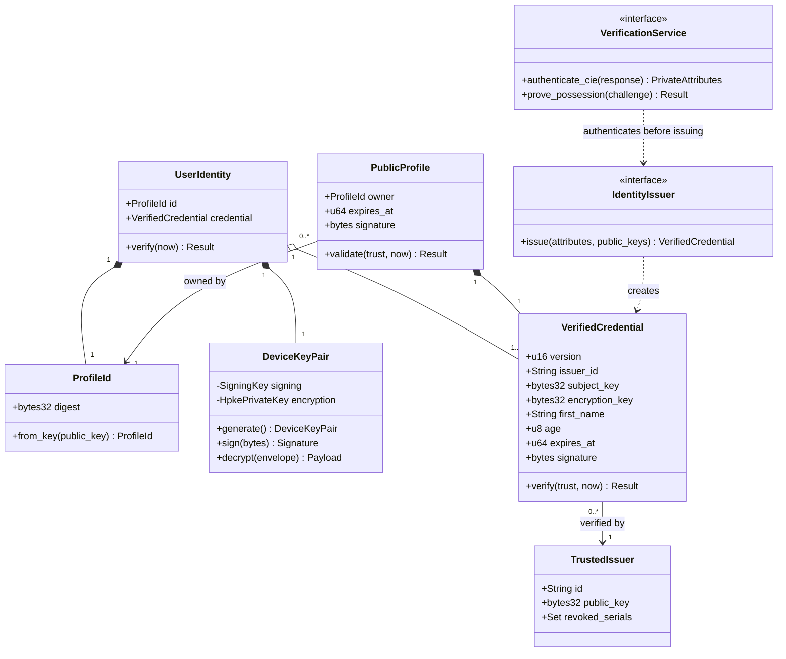

## A. Identity and account

Mapping: core::identity structs DeviceKeyPair, VerifiedCredential, TrustedIssuer; core::protocol ProfileId/PublicProfile; IdentityIssuer trait. UserIdentity is account aggregate; VerificationService is planned CIE adapter trait/module. Invariants: credential subject matches owner and signing proof; issuer binds both keys; public age/name derived from attestation; private identity attributes never enter DHT. [Identity authority](../../identity.md).
