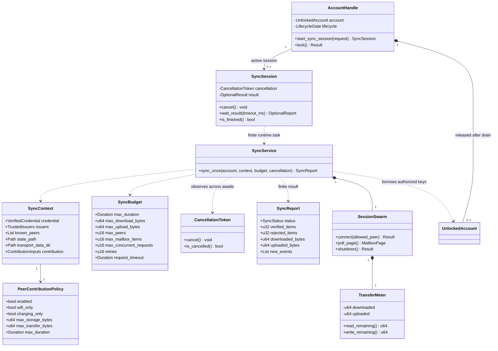

## Bounded synchronization

Mapping: network::sync function/types (SyncService is the module-level operation), raw transport I/O wrapper/meter, existing PeerNode/SQLite; mobile-ffi AccountHandle and SyncSession own native lifecycle. Initial scheduling may be serial, always below requested concurrency ceiling. Invariants: global byte and peer ceilings, outbound-only Annoda RPC admission, no transaction across await, no optional transfers without policy, no swarm after result. Replica batches have distinct owners; a confirmation counts one peer's complete manifest, with Partial for incomplete requested contribution. Start and lock exclude each other; completion follows release of the worker's key reference. Host grant is external and can end at any time. [Lifecycle authority](../../background-sync.md).
