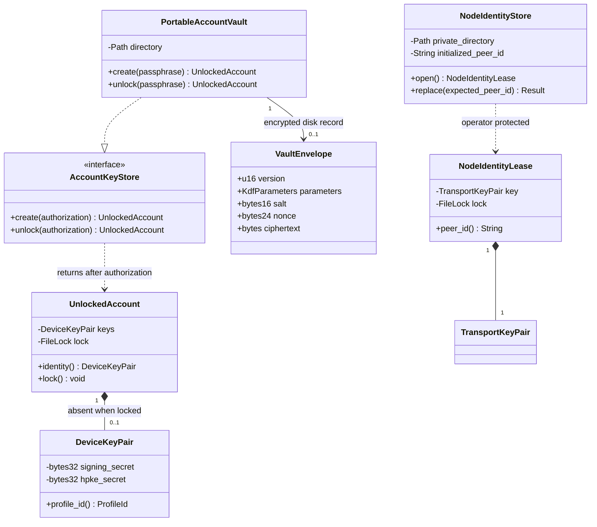

## Identity ownership

Mapping: core key_store trait/structs and identity::DeviceKeyPair; network node_identity store/lease and libp2p keypair. VaultEnvelope serializes only authenticated ciphertext/header, never Debug secrets. UnlockedAccount owns exclusive key-store lock. NodeIdentityLease is separate, filesystem protected plaintext. [Key invariants](../../key-management.md): no open→create fallback, stable account/public keys and PeerId, no raw key ABI.
