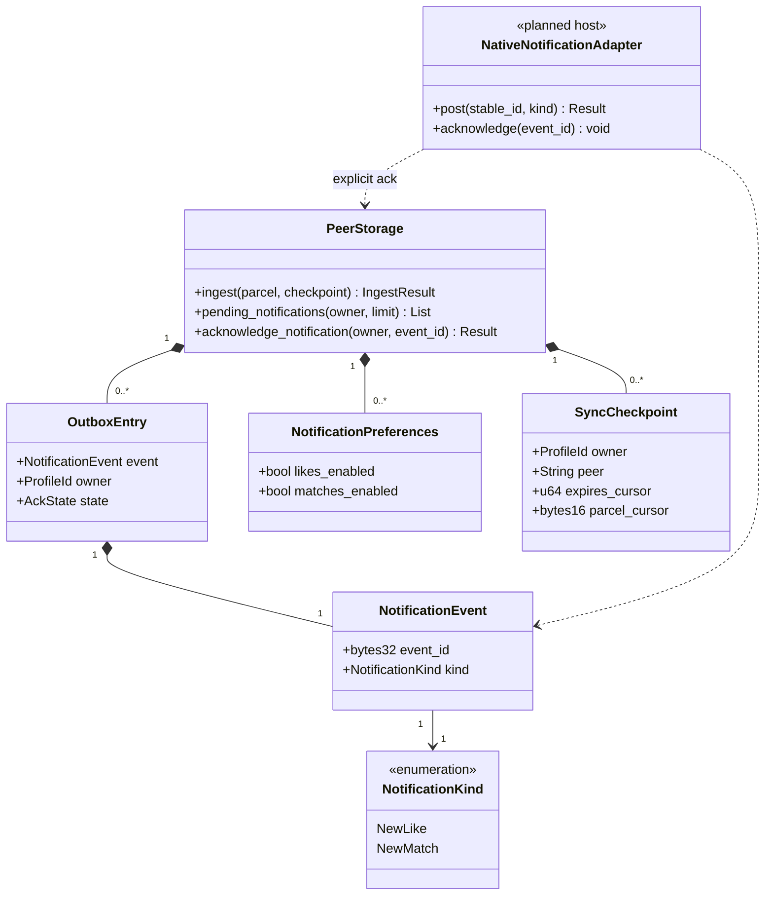

## Transactional notifications

Mapping: additive core SQLite tables/types; UniFFI DTOs export only event id/kind. State/evidence/outbox/checkpoint commit atomically. Returning events leaves Pending unchanged. Native adapters may retry at least once and must use stable ids. [Notification authority](../../notifications.md).
