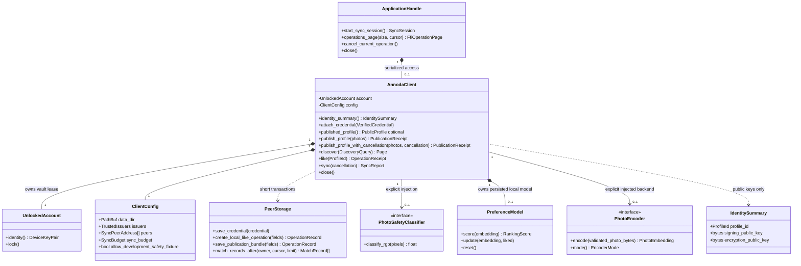

# Application service and owned state

Status: M3 contract; delivery tracked in [progress](../../progress.md).

Rust mapping: `annoda_network::client` owns AnnodaClient/config/DTOs; core key_store/storage remain the underlying owners; intelligence traits/model are reused. `annoda_mobile_ffi` owns its opaque adapter handle. Invariants: exclusive vault lease, no private key export, no SQL transaction across await, current issuer/key validation at trust boundaries.

Authority: [application API](../../application-api.md), [durable operations](../../durable-operations.md).

Application preferences and local reports are implemented in the private `client::ranking_reporting` child module while retaining AnnodaClient as their public owner. Core stores validated versioned opaque model bytes without an intelligence dependency.
