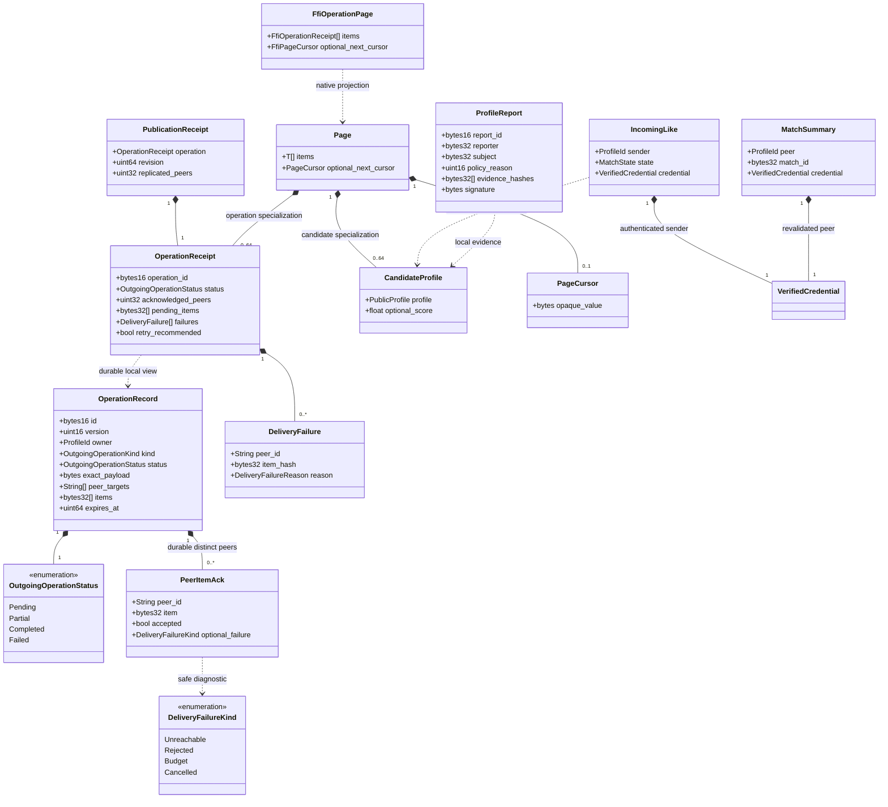

# Durable operations and query DTOs

Status: M3 contract; delivery tracked in [progress](../../progress.md).

Rust mapping: `annoda_core::storage::{OperationRecord, OutgoingOperationStatus, PeerItemAck, DeliveryFailureKind}` own durable records and acknowledgement transactions. `annoda_network::client` owns OperationReceipt, DeliveryFailure, PublicationReceipt, CandidateProfile, Page<T>, PageCursor, IncomingLike and MatchSummary. DeliveryFailureReason projects the storage failure enum without exposing transport errors. `annoda_intelligence::safety::ProfileReport` is reused by the private client ranking_reporting module. UniFFI maps these into its Ffi-prefixed records.

Invariants: exact work survives retry; only peers accepting all required items count as full replicas; accepted acknowledgements cannot be downgraded; Incoming is visible before Matched; signed local reports imply no remote moderation acceptance. Page multiplicity is a return bound, not a collection truncation policy: validated cursors must reach subsequent eligible records. Contacts and private preferences never enter public profile records.

Authority: [application API](../../application-api.md), [durable operations](../../durable-operations.md).
