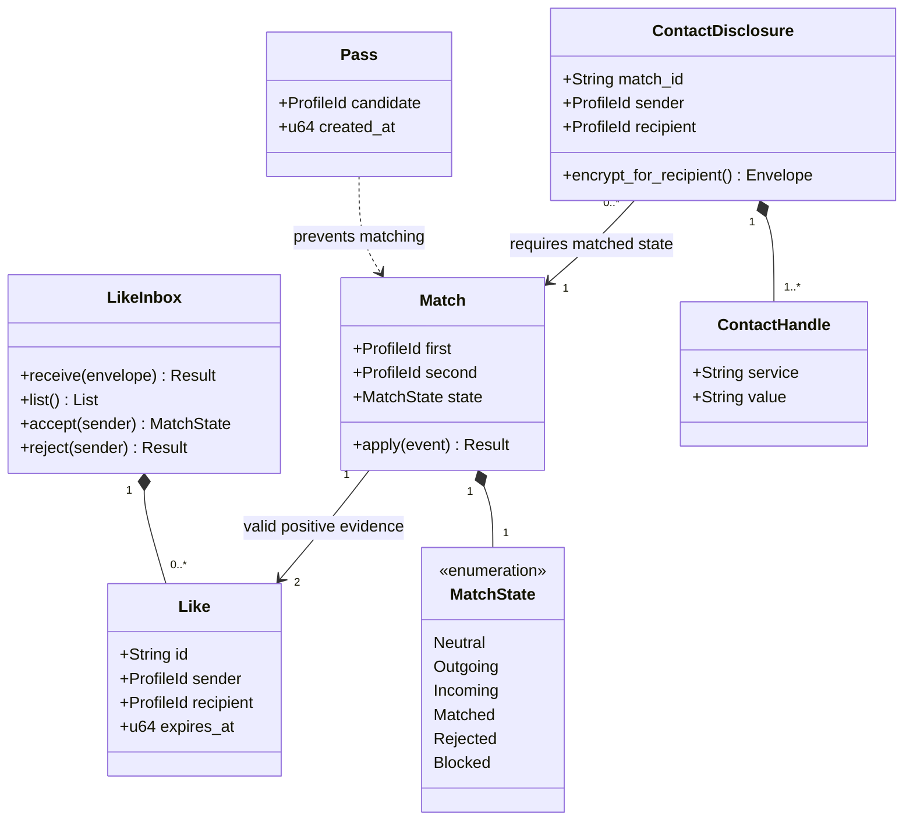

## C. Matching

Mapping: core::matching structs/enums and SQLite inbox/state service. LikeInbox and Match may be service/record combinations; MatchState is enum; Pass can map private state transition. Invariants: sender authenticated, recipient alone decrypts, duplicates do not reapply, rejection/blocking cannot be bypassed by delay, contacts gated separately. [State table](../../matching.md).
