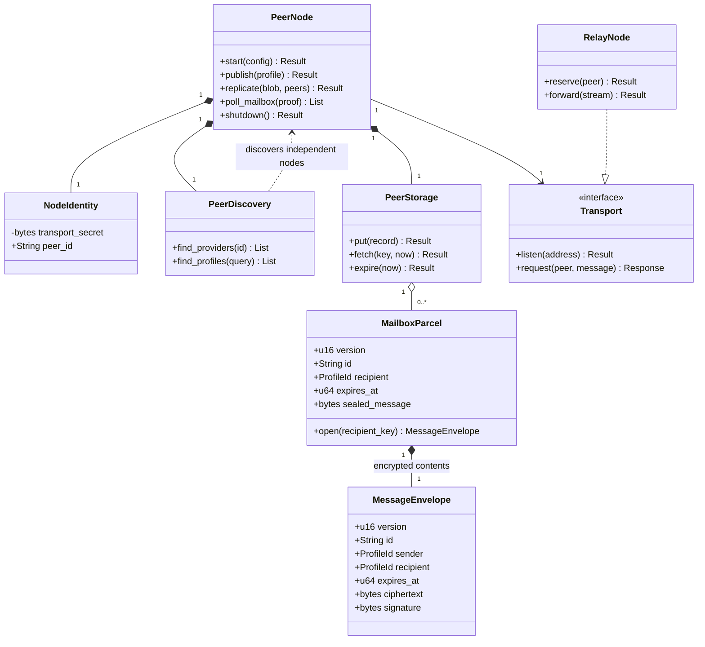

## D. Network

Mapping: network PeerNode actor, libp2p identity NodeIdentity, Kademlia PeerDiscovery, request/response Transport; core protocol MessageEnvelope, SQLite PeerStorage. RelayNode is planned libp2p circuit-relay adapter, not storage forwarding. Invariants: account identity independent of transport; bounded queues/frames; RPC authentication independent of Noise connection. [Network](../../network.md).
