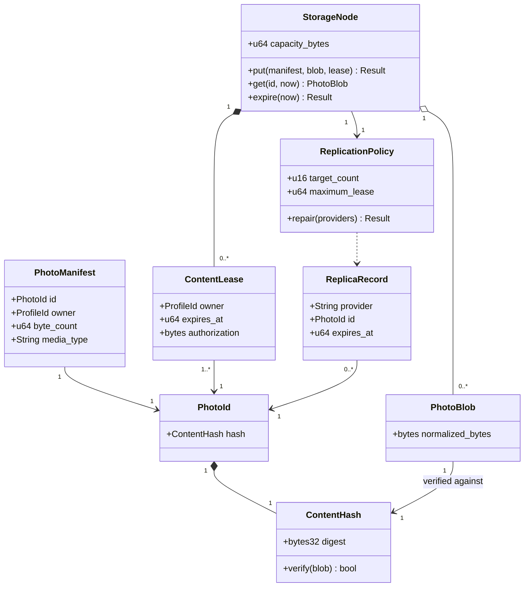

## B. Photographs and distributed storage

Mapping: core::storage content/hash, manifest/blob/lease structs and SQLite PeerStorage; network::replication implements StorageNode/ReplicationPolicy behavior; provider metadata maps ReplicaRecord. Logical wrapper names may be type aliases. Invariants: hash verifies bytes; independent owners have distinct leases; expiry prevents reads immediately; replication success requires distinct acknowledgements. [Storage authority](../../storage.md).
