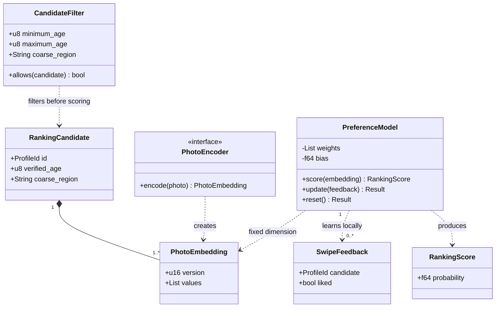

## E. Ranking

Mapping: intelligence::ranking structs PreferenceModel, PhotoEmbedding, RankingCandidate, RankingScore, SwipeFeedback, CandidateFilter and PhotoEncoder trait. Fields may be equivalent wrappers; no scores enter protocol. Invariants: finite vectors, fixed encoder version/dimension, local training, explicit sensitive filters, deterministic test seed. [Mathematics](../../ranking.md).
