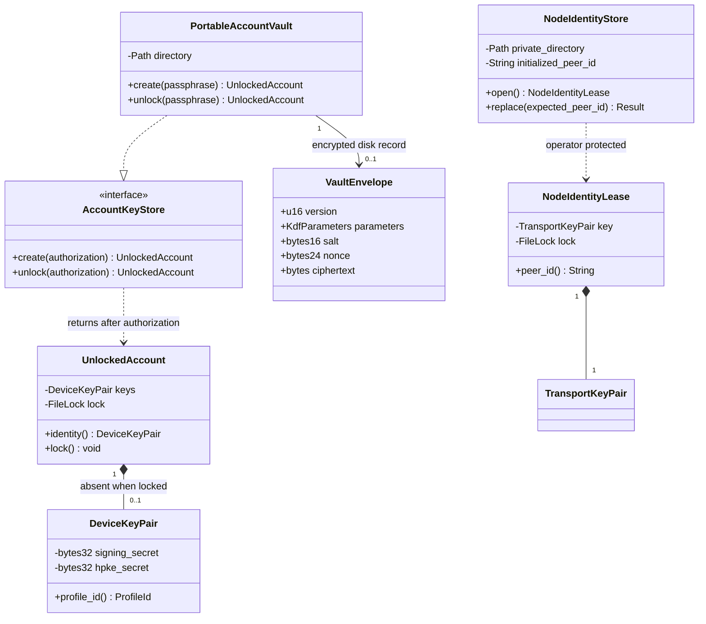
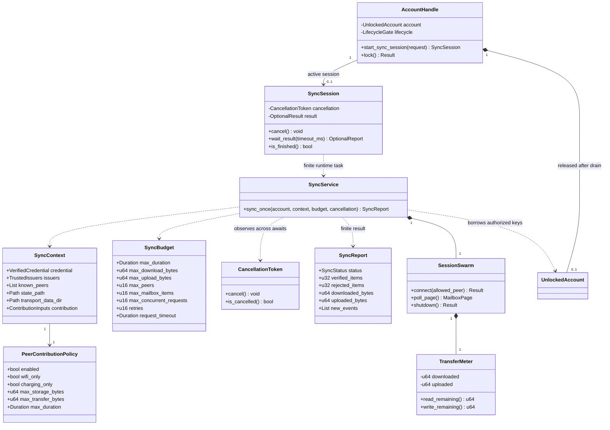
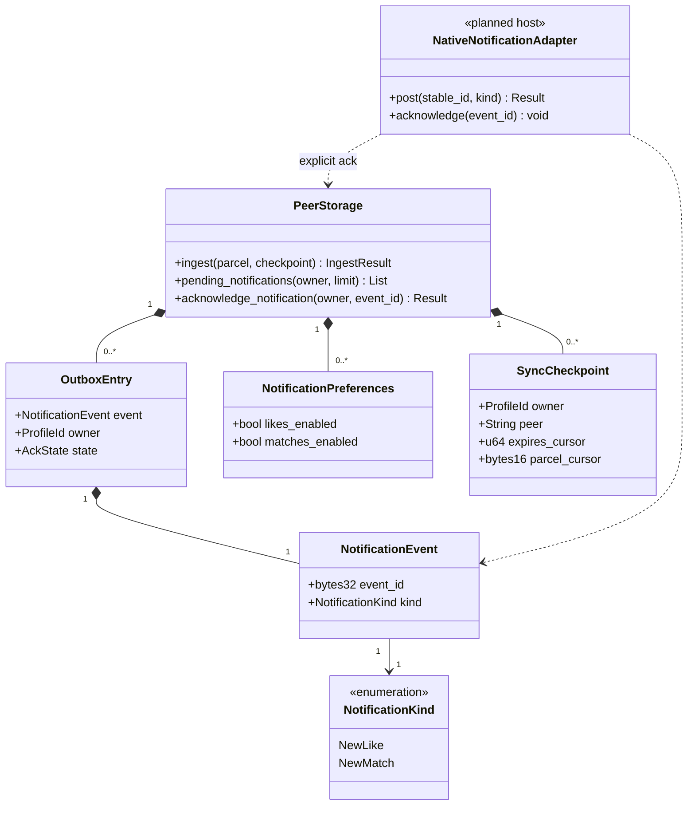
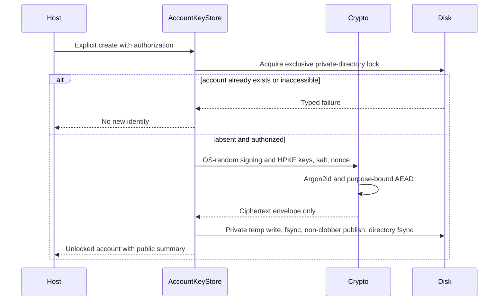
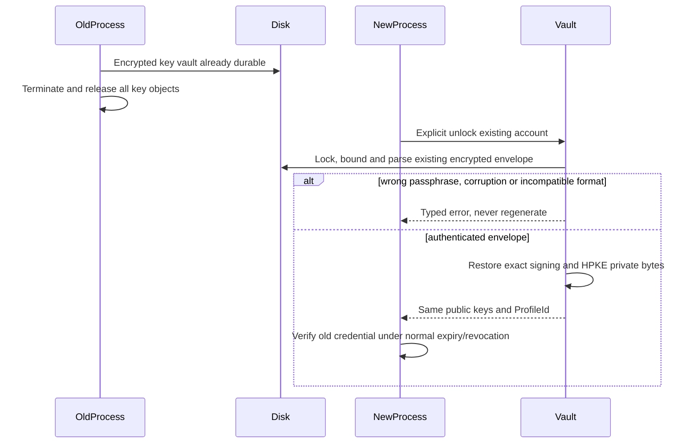
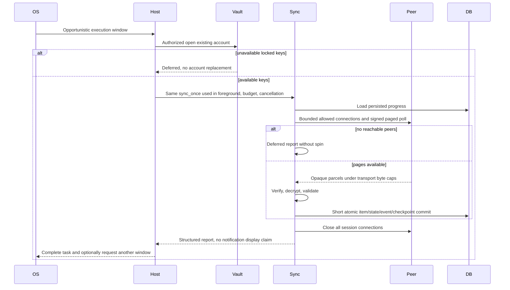
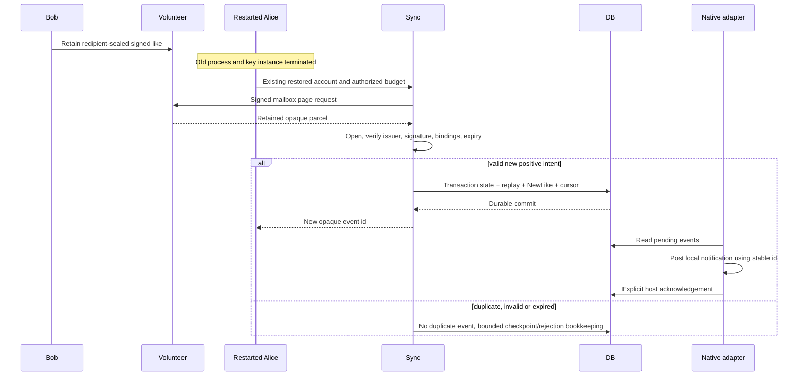
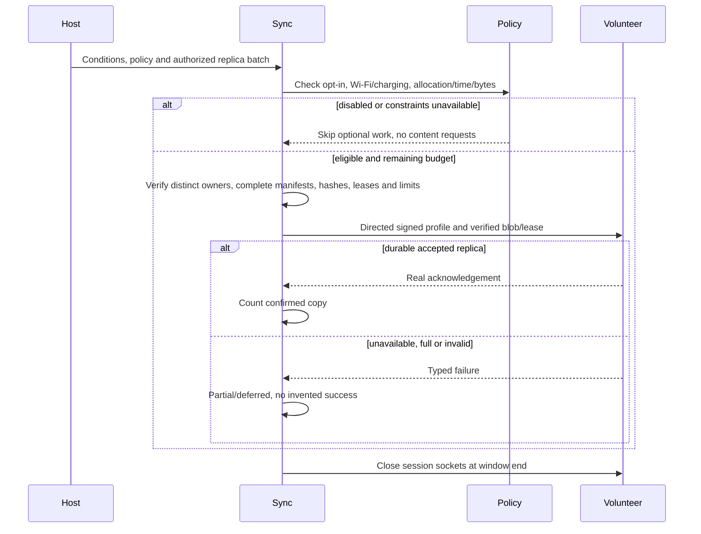
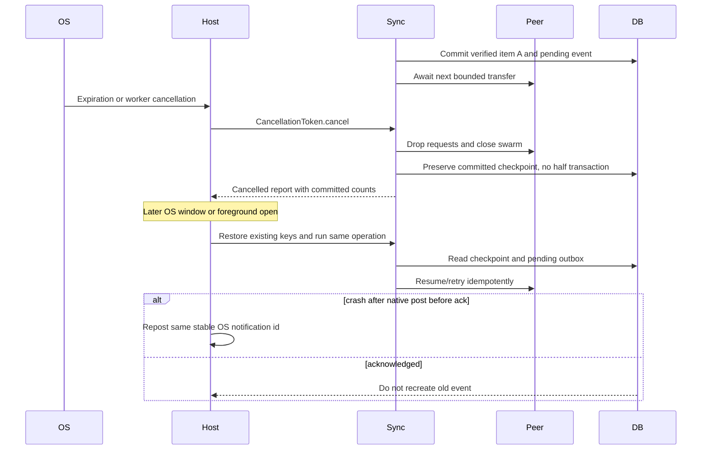
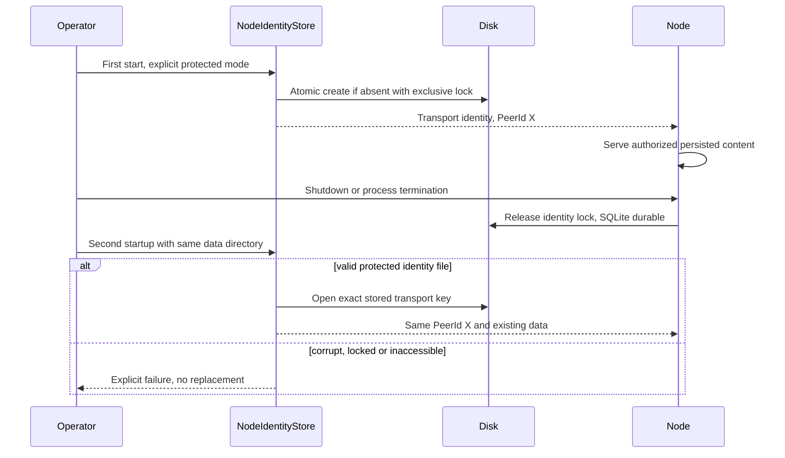

# M2 identity, sync and notification UML

Normative contracts established before code. Delivery status: [progress](../progress.md). Portable Rust mechanisms are milestone targets; Keychain/Keystore and OS schedulers are planned host integrations. No diagram asserts background launch timing.

## Identity ownership

Mapping: core key_store trait/structs and identity::DeviceKeyPair; network node_identity store/lease and libp2p keypair. VaultEnvelope serializes only authenticated ciphertext/header, never Debug secrets. UnlockedAccount owns exclusive key-store lock. NodeIdentityLease is separate, filesystem protected plaintext. [Key invariants](../key-management.md): no open→create fallback, stable account/public keys and PeerId, no raw key ABI.

## Bounded synchronization

Mapping: network::sync function/types (SyncService is the module-level operation), raw transport I/O wrapper/meter, existing PeerNode/SQLite; mobile-ffi AccountHandle and SyncSession own native lifecycle. Initial scheduling may be serial, always below requested concurrency ceiling. Invariants: global byte and peer ceilings, outbound-only Annoda RPC admission, no transaction across await, no optional transfers without policy, no swarm after result. Replica batches have distinct owners; a confirmation counts one peer's complete manifest, with Partial for incomplete requested contribution. Start and lock exclude each other; completion follows release of the worker's key reference. Host grant is external and can end at any time. [Lifecycle authority](../background-sync.md).

## Transactional notifications

Mapping: additive core SQLite tables/types; UniFFI DTOs export only event id/kind. State/evidence/outbox/checkpoint commit atomically. Returning events leaves Pending unchanged. Native adapters may retry at least once and must use stable ids. [Notification authority](../notifications.md).

## Sequence 1: First account creation and secure storage

Rust portable vault target. Native protection adapters planned.

## Sequence 2: Restore after complete process restart

Rust target includes fresh process proof. Credential renewal is not implicit.

## Sequence 3: OS-triggered finite P2P synchronization

OS scheduler planned host adapter, actual service Rust target.

## Sequence 4: Offline like and local notification event

Rust outbox and network target, actual OS notification display planned.

## Sequence 5: Voluntary cooperation in temporary window

M2 target forwards existing authorized replicas. Inbound mobile provider mode planned.

## Sequence 6: Cancellation and recovery

Rust target commits per item and returns boundedly.

## Sequence 7: Stable volunteer restart

Rust filesystem-protected transport store target.

