# Interaction sequences

Each status describes milestone target versus planned adapter. Actual shipped coverage and proof: [progress](../progress.md).

## 1. Registration and CIE credential issuance

Milestone: synthetic development issuance and peer verification. Planned: real CIE adapter and interactive possession challenge.

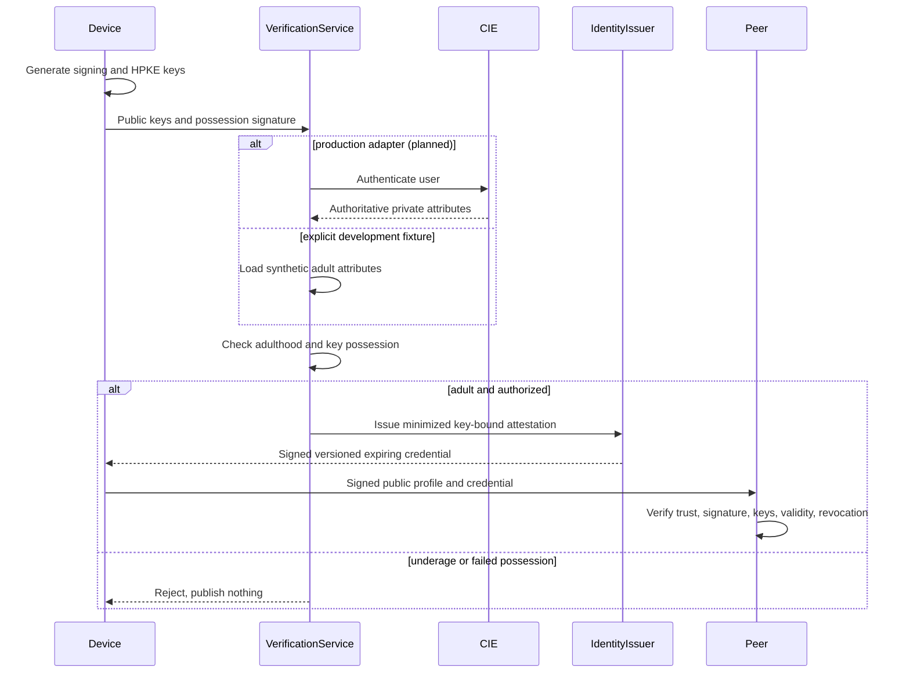

## 2. Profile creation and publication

Milestone target: signed profile and actual directed volunteer transfer. Planned: global discovery policy and durable DHT publication renewal.

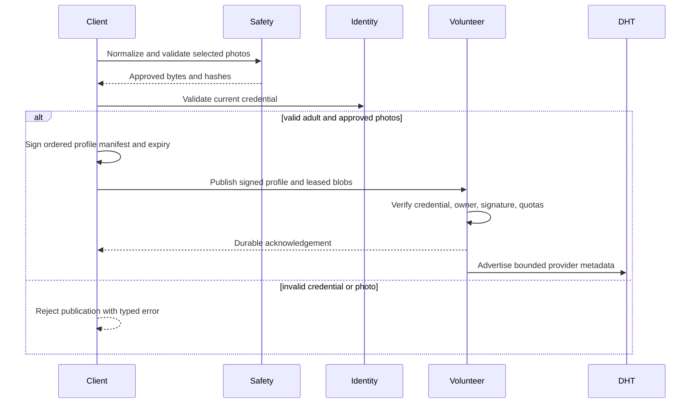

## 3. Local photo validation before upload

Milestone: decode, limits, metadata normalization and deterministic test classifier. Planned: actual mobile model inference.

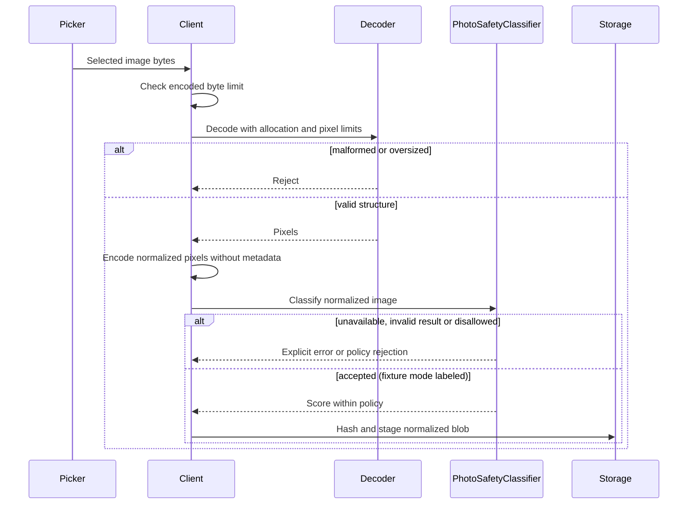

## 4. Photograph replication

Milestone: distinct real local nodes, hash checking, retained leases. Planned: periodic repair and diverse provider placement.

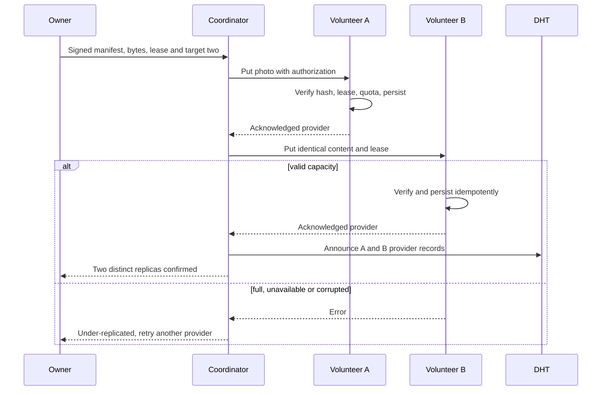

## 5. Discovery and image retrieval

Milestone target: actual network profile discovery and volunteer image retrieval while owner offline. Planned: selective geographic DHT indexing.

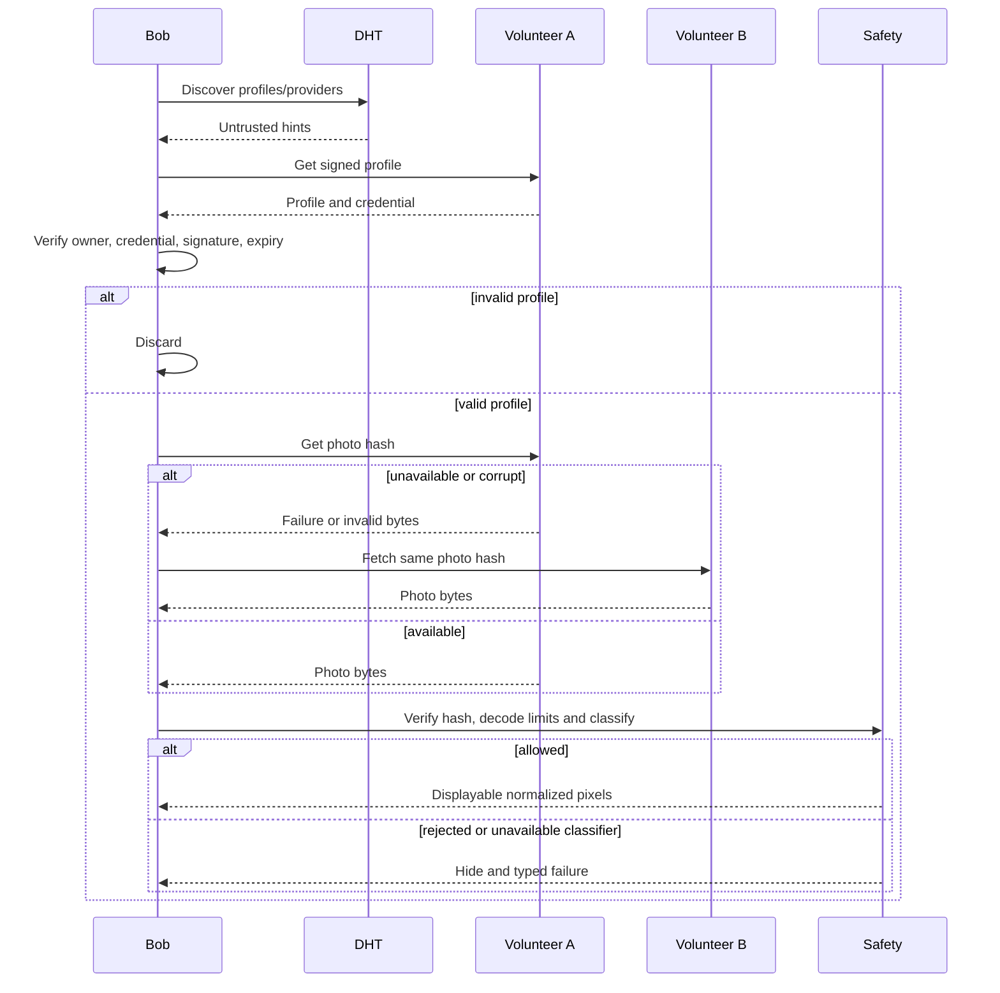

## 6. Like to online user

Milestone target: signed HPKE payload over actual directed RPC. No public broadcast.

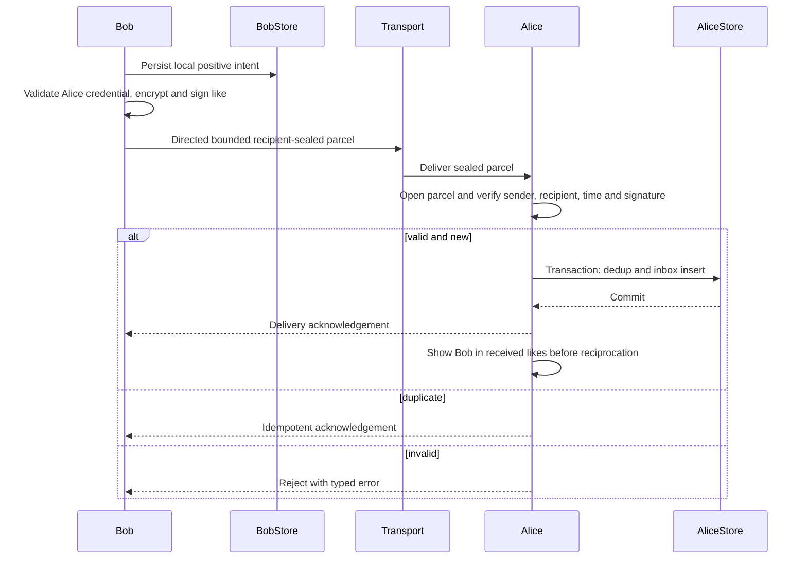

## 7. Offline like and later retrieval

Milestone target: durable volunteer ciphertext plus recipient retrieval. Planned production challenge freshness is tracked explicitly.

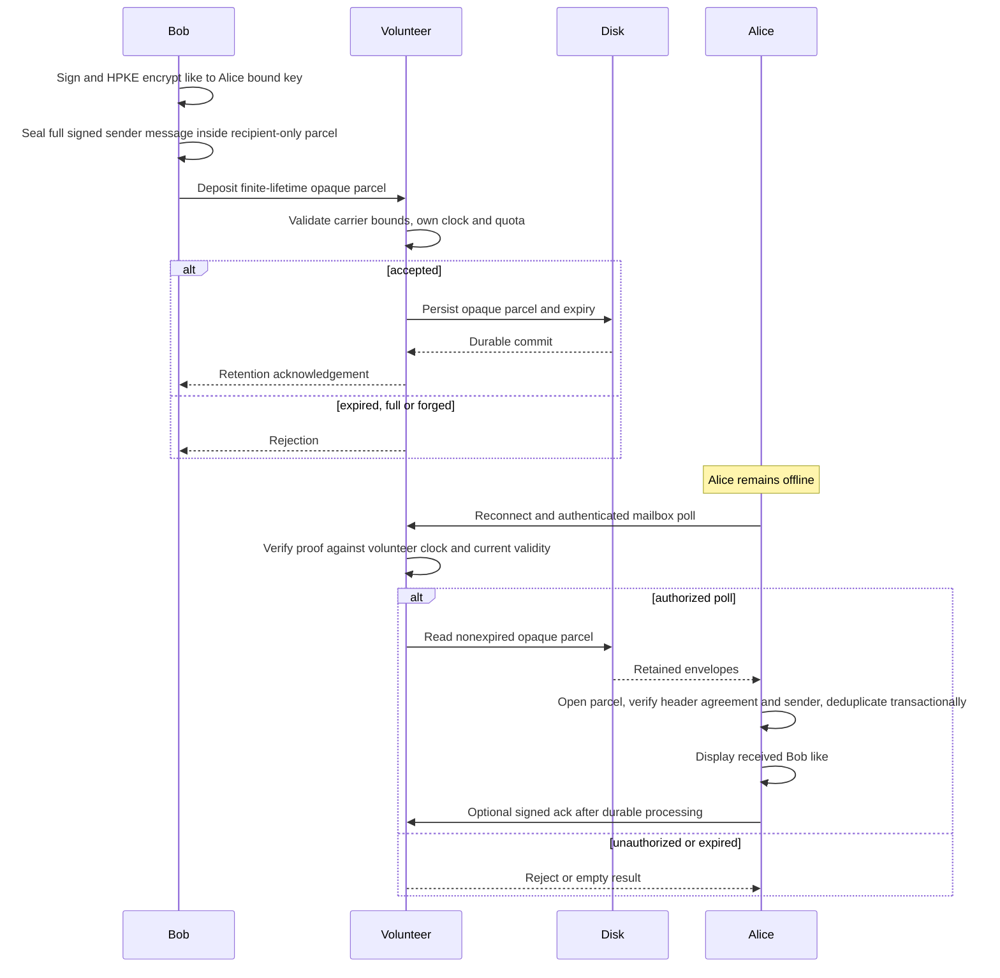

## 8. Mutual matching

Milestone: domain state machine and actual positive intent exchange. Match visibility waits for both authenticated intents.

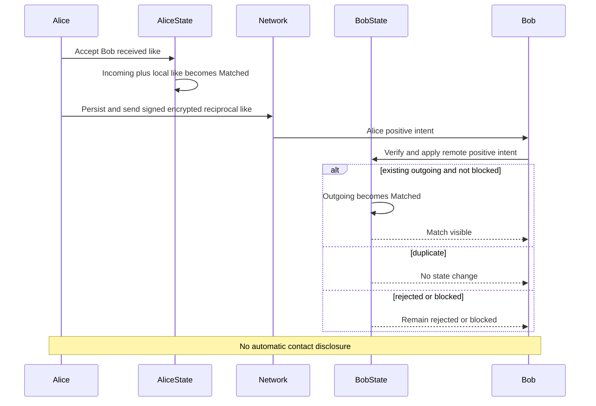

## 9. Explicit external contact disclosure

Milestone target: match gate, encrypted contact payload and recipient validation.

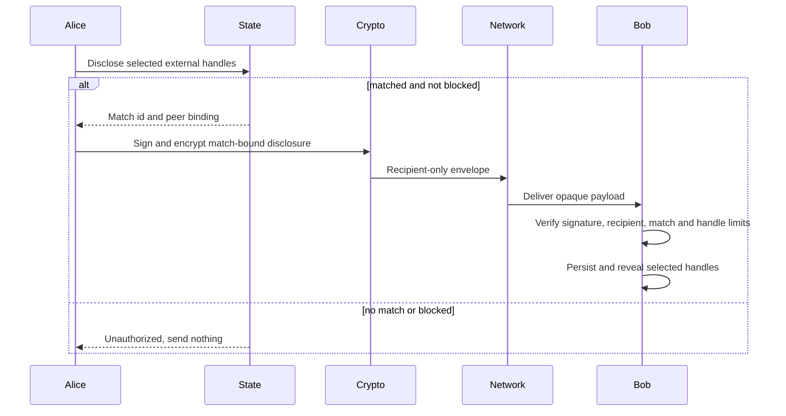

## 10. Blocking and reporting

Milestone: local block and report interfaces. Planned: explicit community report transport and trusted moderation decisions.

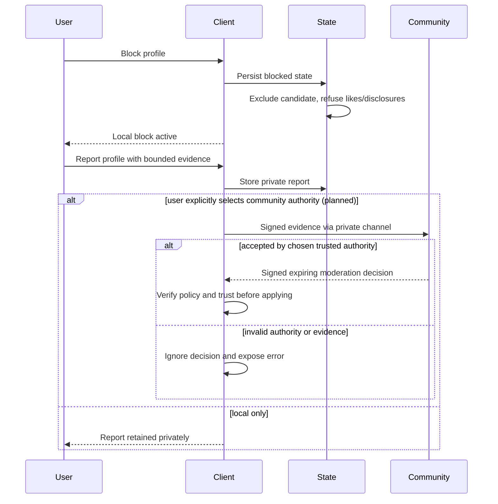

## 11. Credential expiration, renewal and revocation

Milestone: explicit-time expiry and trusted revocation-set validation. Planned: fresh signed snapshot distribution and real renewal adapter.

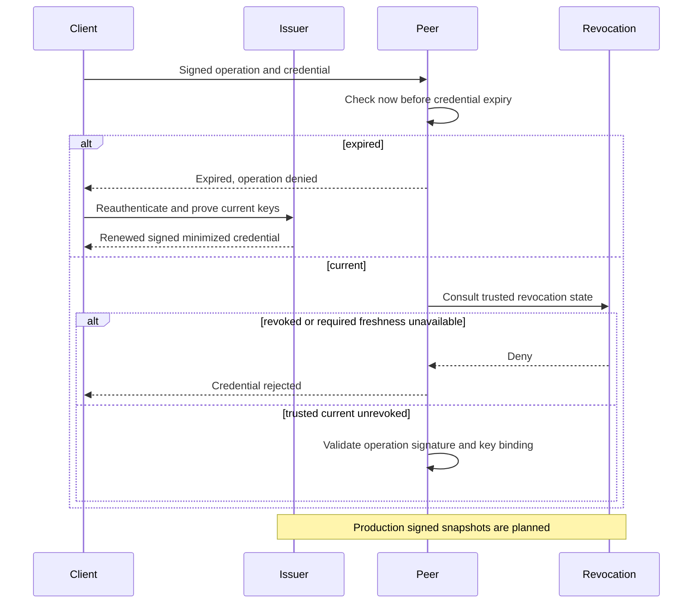

## 12. Photo removal, tombstones and expiration

Milestone: local lease expiration and storage removal. Planned: signed monotonic tombstone propagation and stale-record suppression.

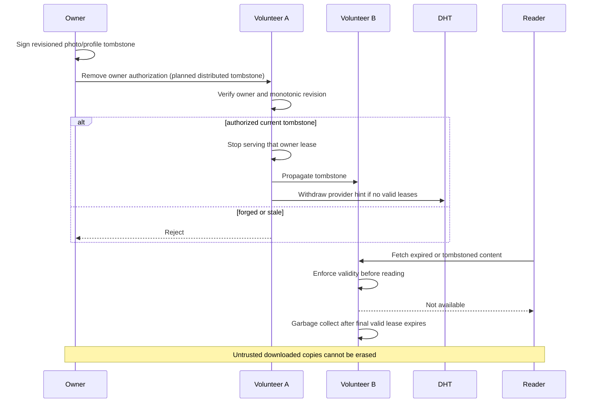

