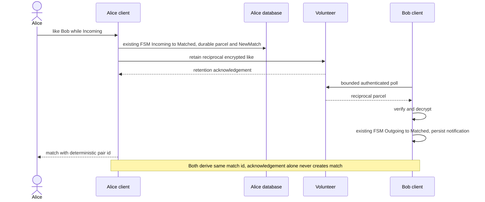

# Reciprocal positive intent

Status: M3 contract before implementation, [progress](../../progress.md) records actual proof.

Participants map to `annoda_network::client::AnnodaClient`, core `PeerStorage`/`AccountKeyStore`, intelligence `PhotoProcessor` and existing finite libp2p volunteer RPCs. Native UI and real CIE adapters remain planned. [Application contract](../../application-api.md), [operation contract](../../durable-operations.md).
